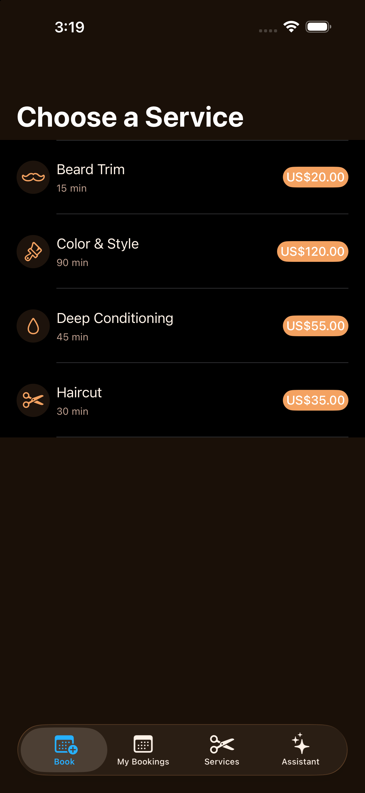
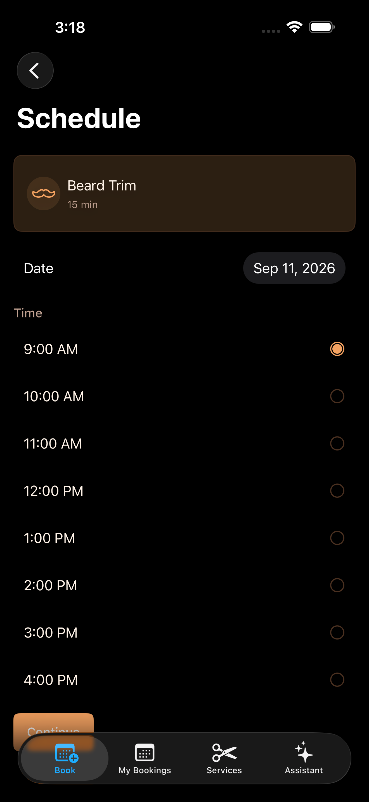
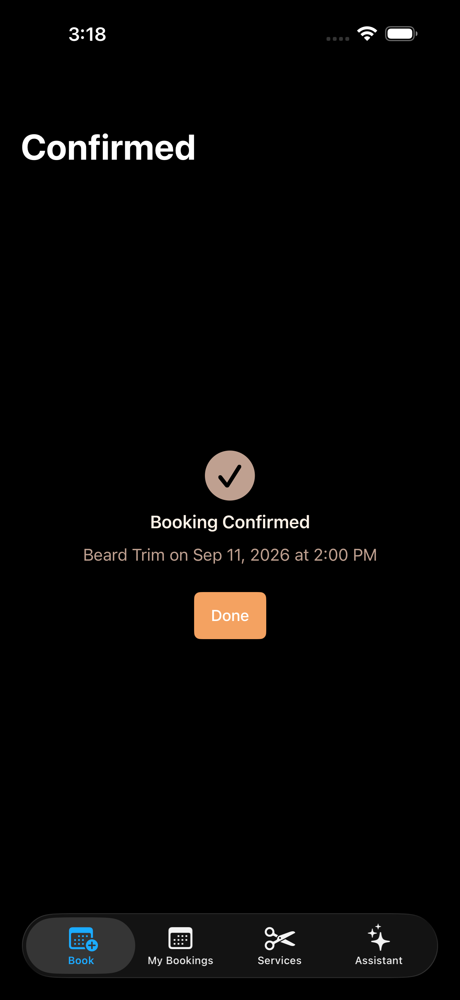
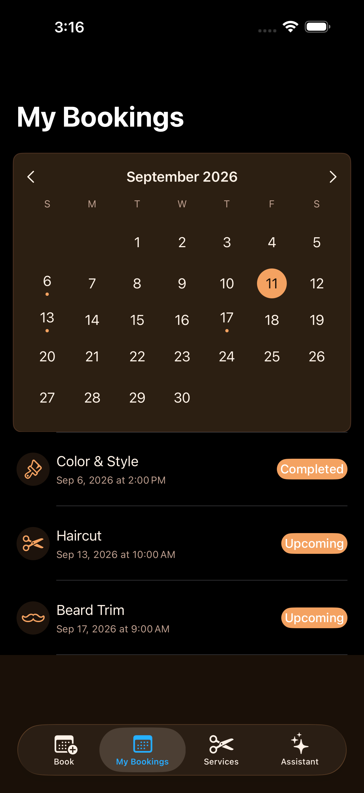
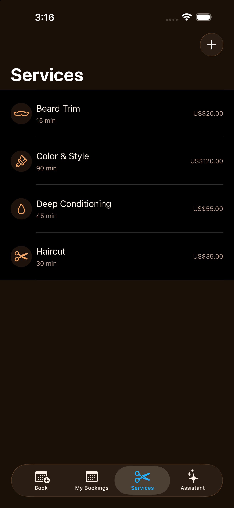
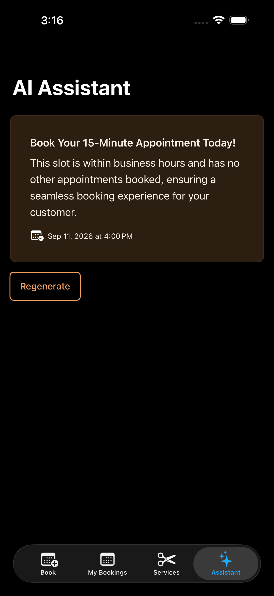

# BookLens

[](https://github.com/NerdSnipe-Inc/BookLens)
[](https://github.com/NerdSnipe-Inc/BookLens)
[](LICENSE)
[](https://github.com/NerdSnipe-Inc/design-foundation)

**BookLens** is an open-source [SwiftUI appointment booking app](https://github.com/NerdSnipe-Inc/BookLens)
for iOS — a full-source, production-quality example of a service-business scheduler, built from
real, reusable components instead of throwaway demo code. It's a companion example to
[AICompleteChat](https://github.com/NerdSnipe-Inc/AICompleteChat) and
[BudgetLens](https://github.com/NerdSnipe-Inc/BudgetLens), applying the same
[DesignFoundation](https://github.com/NerdSnipe-Inc/design-foundation) /
[DesignFoundation Pro](https://github.com/NerdSnipe-Inc/DesignFoundationPro) design system and
on-device [Apple Intelligence](https://github.com/NerdSnipe-Inc/BookLens) stack to a
scheduling use case.

Every screen in the booking flow — service selection, time-slot scheduling, confirmation, and
"My Bookings" — comes from [DesignFoundation Pro's `Booking` UI kit](https://github.com/NerdSnipe-Inc/DesignFoundationPro),
wired to real SwiftData persistence. Confirming a booking offers to add it straight to the
user's Calendar via [EventKitUI](https://github.com/NerdSnipe-Inc/BookLens) — Apple's
zero-permission, zero-prompt way to add a single event — and the "AI Assistant" tab uses
on-device [Foundation Models](https://github.com/NerdSnipe-Inc/BookLens) to explain, in plain
language, why a particular open slot is being suggested.

Looking for a real-world **[SwiftUI booking app template](https://github.com/NerdSnipe-Inc/BookLens)**,
a working **[EventKit calendar integration example](https://github.com/NerdSnipe-Inc/BookLens)**,
or a buildable reference for **[`LanguageModelSession` and `@Generable` structured output](https://github.com/NerdSnipe-Inc/BookLens)**
on iOS 26? This is a full app, not a snippet.

## Built With

- [**DesignFoundation**](https://github.com/NerdSnipe-Inc/design-foundation) — the free,
  open-source [SwiftUI design system](https://github.com/NerdSnipe-Inc/design-foundation) behind
  every button, text field, list row, calendar, and theme in this app.
- [**DesignFoundation Pro**](https://github.com/NerdSnipe-Inc/DesignFoundationPro) — the premium
  [SwiftUI booking UI kit](https://github.com/NerdSnipe-Inc/DesignFoundationPro) (service
  selection, scheduling, confirmation, and bookings-list screens, plus 11 other full app
  verticals) that BookLens's booking flow is assembled from wholesale.
- **Apple Foundation Models** — on-device [Apple Intelligence](https://github.com/NerdSnipe-Inc/BookLens)
  for the AI Assistant tab, via `LanguageModelSession` and `@Generable`.
- **EventKitUI** — `EKEventEditViewController`, Apple's zero-permission way to add a single
  event to Calendar without ever requesting broad calendar access.
- **SwiftData** — local persistence for services and appointments.

## Screenshots

| Book | Schedule | Confirmed |
|---|---|---|
|  |  |  |

| My Bookings | Services | AI Assistant |
|---|---|---|
|  |  |  |

## What it does

- **A booking flow built from a real design system** — `DFBookingServiceSelectionScreen` →
  `DFBookingScheduleScreen` → `DFBookingConfirmationScreen`, wired to real SwiftData services
  and appointments instead of the vertical's in-memory preview data.
- **A "My Bookings" calendar** — `DFCalendarView` with a dot marker on any day that has an
  appointment, above the real bookings list.
- **Add to Calendar with zero permission prompts** — confirming a booking presents
  `EKEventEditViewController` (EventKitUI) directly; no `NSCalendarsUsageDescription` prompt,
  no calendar access requested at all, because the app never reads the user's calendar.
- **An on-device AI scheduling assistant** — the *actual* next open slot is always computed
  deterministically (`SlotFinder`, unit tested); Foundation Models is only asked to narrate
  *why* that slot makes sense, so the assistant can never suggest a time that doesn't really
  exist in the schedule. Gracefully degrades to just the computed slot (no write-up) on devices
  or OS versions without Apple Intelligence.
- **Service management** built from DesignFoundation's core components (`DFList`, `DFEntityRow`,
  `DFTextField`, `DFEmptyState`).

## Requirements

- iOS 18+ (the AI Assistant tab additionally requires iOS 26+ with Apple Intelligence enabled
  to generate the write-up; the deterministic next-open-slot logic and the rest of the app work
  fully on iOS 18)
- Xcode 26+
- [xcodegen](https://github.com/yonaskolb/XcodeGen) (`brew install xcodegen`) — this repo has no
  committed `.xcodeproj`; regenerate it from `project.yml`
- **A [DesignFoundationPro](https://github.com/NerdSnipe-Inc/DesignFoundationPro) license.** This
  is the one intentional gate: the source here is meant to be read and learned from by anyone,
  but it only actually *builds* for someone with access to DesignFoundationPro, since the
  booking flow is assembled from its `Booking` vertical rather than built from scratch.

  Without access, package resolution fails outright — you'll see something like this during
  `xcodegen generate` + build, or from Xcode's own package resolution:
  ```
  error: Failed to clone repository https://github.com/NerdSnipe-Inc/DesignFoundationPro.git:
      remote: Repository not found.
      fatal: repository 'https://github.com/NerdSnipe-Inc/DesignFoundationPro.git/' not found
  ```
  That's expected, not a bug in this repo: it means your GitHub account isn't on
  DesignFoundationPro's access list. [Grab a
  license](https://github.com/NerdSnipe-Inc/DesignFoundationPro) to fix it.

[DesignFoundation](https://github.com/NerdSnipe-Inc/design-foundation) (the free SwiftUI
design-system core) is public and resolves automatically via Swift Package Manager.

## Building

```sh
git clone https://github.com/NerdSnipe-Inc/BookLens.git
cd BookLens
xcodegen generate
open BookLens.xcodeproj
```

Build and run the `BookLens` scheme on a simulator or device. The app seeds a handful of
services and appointments on first launch so the flow and the assistant have real data
immediately.

## Architecture

```
BookLens/
  ContentView.swift          — four-tab shell: Book, My Bookings, Services, Assistant
  Models/
    Service.swift            — SwiftData model: name, duration, price, icon
    Appointment.swift        — SwiftData model: date, status, service
    SampleData.swift         — first-launch seed data
  Store/
    SlotFinder.swift         — pure availability/next-open-slot logic (no SwiftData/SwiftUI/
                                FoundationModels dependency — unit tested directly)
  Booking/
    BookingFlowView.swift    — wires the Pro Booking vertical's screens to SwiftData + calendar add
    AddToCalendarView.swift  — EKEventEditViewController wrapper (EventKitUI, zero permissions)
  MyBookings/
    MyBookingsView.swift     — DFCalendarView + DFMyBookingsScreen
  Services/                  — service management (DFList/DFEntityRow + add-service sheet)
  Assistant/
    SchedulingAssistantEngine.swift — LanguageModelSession + @Generable SchedulingRationale, iOS 26+
    SchedulingAssistantView.swift   — loading skeleton, suggestion card, unavailable fallback
```

The booking flow reuses DesignFoundationPro's `Booking` vertical screens directly (not its
`DFBookingRootView` convenience wrapper) because persisting to SwiftData and offering the
EventKitUI add-to-calendar step needs seams that convenience view doesn't expose. See
DesignFoundationPro's own docs for how the vertical is put together.

## Related Projects

- DesignFoundation — the [free SwiftUI design system](https://github.com/NerdSnipe-Inc/design-foundation) this app (and its UI) is built on.
- DesignFoundation Pro — the [premium vertical UI kits for Swift](https://github.com/NerdSnipe-Inc/DesignFoundationPro) (Booking, Analytics, AI Chat, CRM, E-commerce, and more) BookLens's booking flow uses.
- AICompleteChat — the sibling full-source example app: an [on-device AI chat client example](https://github.com/NerdSnipe-Inc/AICompleteChat) built the same way.
- BudgetLens — the sibling full-source example app: a [SwiftUI budget tracker with on-device AI insights](https://github.com/NerdSnipe-Inc/BudgetLens) built the same way.

## License

MIT — see [LICENSE](LICENSE). Note this only covers the code in *this* repo; DesignFoundationPro
is licensed separately (see its own repo).

---

**Keywords:** SwiftUI booking app, appointment scheduler iOS, EventKit calendar integration
example, EventKitUI example, SwiftData scheduling app, on-device AI scheduling assistant,
Apple Intelligence example, Foundation Models Swift example, LanguageModelSession @Generable,
SwiftUI design system, SwiftUI booking UI kit, open source iOS app example.
